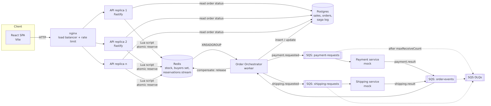
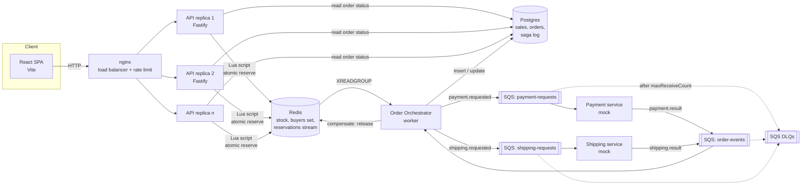

# Flash Sale System

One product, limited stock, a fixed time window, one item per user, and heavy concurrent load.
Each purchase is decided atomically in Redis, so the system cannot oversell. Payment and shipping
then run as an orchestrated saga over SQS.

- Spec: [`doc/SPEC.md`](doc/SPEC.md)
- Plan: [`doc/PLAN.md`](doc/PLAN.md)
- How to read stress output: [`stress/README.md`](stress/README.md)

## Contents

- [Tested on](#tested-on)
- [Prerequisites](#prerequisites)
  - [Linux (default)](#linux-default)
  - [macOS](#macos)
  - [Windows](#windows)
- [Quick start](#quick-start)
- [Architecture](#architecture)
- [Design choices and trade-offs](#design-choices-and-trade-offs)
- [Running it](#running-it)
  - [Full stack](#full-stack)
  - [Development](#development)
  - [Configuration](#configuration)
  - [Tests](#tests)
  - [Stress](#stress)
- [Stress results](#stress-results)
- [Repository layout](#repository-layout)

## Tested on

- Linux (Fedora 44): rootless Podman as the engine, with the Docker CLI and Compose plugin.
- macOS (MacBook Pro M5): Colima, with the Docker CLI and `docker-compose`.
- Windows (WSL 2): rootless Podman inside Ubuntu as the engine, with the Docker CLI and Compose plugin.

## Prerequisites

- Node 24+ and pnpm 12 (`npx get-pnpm`).
- A container runtime with a Compose v2 CLI that supports `up --wait`. `podman-compose` is not
  supported.
- A POSIX shell (bash or zsh). The `test:int`, `stack:*`, `stress` and `chaos` scripts source
  `.envrc`, and `chaos` runs `stress/chaos.sh`.

`.envrc` does two things. When `DOCKER_HOST` is unset and a rootless Podman socket exists, it points
`DOCKER_HOST` at that socket. It also sets `CONTAINER_SOCKET`, the engine socket mounted into Floci:
the `DOCKER_HOST` socket on Linux, `/var/run/docker.sock` everywhere else. Both are only set when you
haven't set them yourself. Run `source .envrc` (or `direnv allow`) to use plain `docker` commands
against the same stack.

Ports `8080`, `6379`, `5432` and `4566` must be free. The setups marked **tested** below have been
verified end to end (see [Tested on](#tested-on)); the others have not.

### Linux (default)

Either runtime works:

- **Rootless Podman 5 (tested)**, driven through the `docker` CLI and the Compose plugin (Docker
  Engine is not required). Enable the socket:

  ```bash
  systemctl --user enable --now podman.socket
  ```

  `.envrc` finds it at `$XDG_RUNTIME_DIR/podman/podman.sock`. Under SELinux, Testcontainers' reaper
  (Ryuk) must run privileged; `.envrc` sets `TESTCONTAINERS_RYUK_PRIVILEGED=true`, which is still
  only your user's privileges.

- **Docker Engine** with the Compose plugin (`docker compose version`), used as is. Add yourself to
  the `docker` group or use rootless Docker.

Then follow the [Quick start](#quick-start).

### macOS

Install Node 24+ and pnpm (`nvm install --lts`, then `npx get-pnpm`), and one of these
runtimes. On Apple Silicon every image used here has an arm64 build.

- **Colima (tested)**

  ```bash
  brew install colima docker docker-compose
  colima start --cpu 4 --memory 8
  ```

  Register the Compose plugin as Homebrew prints it (`cliPluginsExtraDirs` in
  `~/.docker/config.json`). The `docker` CLI uses the `colima` context, but Testcontainers reads
  `DOCKER_HOST`, so before `pnpm test:int` export:

  ```bash
  export DOCKER_HOST="unix://$HOME/.colima/default/docker.sock"
  export TESTCONTAINERS_DOCKER_SOCKET_OVERRIDE=/var/run/docker.sock
  ```

  The override is the socket path inside the Colima VM, which Ryuk mounts. `CONTAINER_SOCKET`
  keeps its `/var/run/docker.sock` default for the same reason.

- **Docker Desktop.** Nothing else to do: the CLI, Compose and `/var/run/docker.sock` come with it.

- **Podman machine.**

  ```bash
  brew install docker docker-compose   # the docker CLI and Compose plugin; Podman ships its own engine
  podman machine init --cpus 4 --memory 8192
  podman machine start
  sudo /opt/podman/bin/podman-mac-helper install   # exposes /var/run/docker.sock
  podman machine stop && podman machine start
  ```

  The helper path depends on how Podman was installed (`brew` puts it under `$(brew --prefix)/bin`).
  `.envrc` does not look for a Podman socket on macOS, so the `docker` CLI uses
  `/var/run/docker.sock` directly.

Give the VM at least 4 CPUs and 8 GB: the stack runs 4 API replicas, and the spike and soak runs
are CPU bound. The stress numbers below come from Linux and will be lower inside a macOS VM.

The default macOS bash is 3.2. `stress/chaos.sh` is written to run on it.

### Windows

Use **WSL 2**. The scripts need a POSIX shell, and running from the Windows file system makes bind
mounts and file watching slow. Native PowerShell or `cmd` is not supported.

1. Install WSL 2 with Ubuntu (`wsl --install -d Ubuntu`, from an admin PowerShell) and reboot.
2. Install a runtime, either:
   - Rootless Podman (**tested**) or Docker Engine inside Ubuntu itself, following the
     [Linux](#linux-default) steps. Ubuntu's `podman` package ships no `docker` CLI or Compose
     plugin, so add Docker's apt repository:

     ```bash
     # Add Docker's official GPG key:
     sudo apt update
     sudo apt install ca-certificates curl
     sudo install -m 0755 -d /etc/apt/keyrings
     sudo curl -fsSL https://download.docker.com/linux/ubuntu/gpg -o /etc/apt/keyrings/docker.asc
     sudo chmod a+r /etc/apt/keyrings/docker.asc

     # Add the repository to Apt sources:
     sudo tee /etc/apt/sources.list.d/docker.sources <<EOF
     Types: deb
     URIs: https://download.docker.com/linux/ubuntu
     Suites: $(. /etc/os-release && echo "${UBUNTU_CODENAME:-$VERSION_CODENAME}")
     Components: stable
     Architectures: $(dpkg --print-architecture)
     Signed-By: /etc/apt/keyrings/docker.asc
     EOF

     sudo apt update

     # Install only the CLI and Compose plugin; Podman is the engine:
     sudo apt install -y docker-ce-cli docker-compose-plugin
     ```

   - **Docker Desktop** with the WSL 2 backend, and _Settings → Resources → WSL integration_
     turned on for your Ubuntu distro.

3. Inside Ubuntu, install Node 24 (for example with `nvm`) and `npx get-pnpm`.
4. Clone into the Linux file system (`~/src/...`, not `/mnt/c/...`) and follow the
   [Quick start](#quick-start).

Clone from inside WSL so the files keep LF line endings: a Windows `git` with `core.autocrlf=true`
writes CRLF, which breaks `.envrc` and `stress/chaos.sh`. If you must use a Windows checkout, clone
with `git clone -c core.autocrlf=false`.

Docker Desktop forwards the published ports to Windows, so <http://localhost:8080> opens from a
Windows browser. Under WSL, `uname -s` is `Linux`; with Docker Desktop `DOCKER_HOST` is unset, so
`CONTAINER_SOCKET` falls back to `/var/run/docker.sock`, which Docker Desktop provides in the distro.

## Quick start

With the [Prerequisites](#prerequisites) in place:

```bash
git clone <this repo> && cd flash-sale-system
pnpm i
pnpm stack:down && pnpm stack:up     # builds and starts everything; about a minute the first time
pnpm e2e          # one purchase through to COMPLETED
```

Open <http://localhost:8080>. A fresh stack creates a sale starting 60 seconds after first boot and
lasting 30 minutes. `pnpm e2e` resets the sale to active right away. To remove the stack and its
data, run `pnpm stack:down`.

## Architecture





The source is [`doc/architecture.mmd`](doc/architecture.mmd). To re-export the PNG, run this from
`doc/` (the container user must be able to write there):

```bash
docker run --rm -v "$PWD:/data:z" minlag/mermaid-cli:11.4.2 \
  -i /data/architecture.mmd -o /data/architecture.png -b white -s 2
```

**A purchase, step by step:**

1. `POST /api/purchases` runs `reserve.lua`. In one atomic step it checks the sale window against
   Redis `TIME`, checks the buyers set and the stock, then does DECR, SADD and XADD.
2. The API answers `202 RESERVED` immediately. The user has secured a unit at this point.
3. The orchestrator reads the stream and inserts the order into Postgres.
4. The orchestrator requests payment, then shipping, over SQS. The web UI polls
   `GET /api/purchases/:userId` to show progress.
5. If payment or shipping fails, or payment times out, the order is cancelled. `release.lua` then
   returns the unit to stock, and the user may buy again.

| Service        | Replicas | Role                                                             |
| -------------- | -------- | ---------------------------------------------------------------- |
| `nginx`        | 1        | Round-robin to the API, per-IP `limit_req`, proxies `/` to `web` |
| `web`          | 1        | Static React build                                               |
| `api`          | 4        | Stateless Fastify: reserve, status reads, `/metrics`             |
| `orchestrator` | 2        | Stream consumer group, saga state machine, sweeper               |
| `payment`      | 2        | Mock charge with configurable latency and failure rate           |
| `shipping`     | 1        | Mock shipment with configurable latency and failure rate         |
| `redis`        | 1        | Stock, buyers, holders, reservations stream                      |
| `postgres`     | 1        | Sales, orders, `saga_events`, `processed_messages`               |
| `floci`        | 1        | SQS API, with queues and DLQs created by `queue-init`            |

## Design choices and trade-offs

**Redis decides, not the database.** A single O(1) Lua script makes the decision. Redis runs scripts
one at a time, so purchases are linearizable with no locks and no contended stock row.

- _Cost:_ Redis is a single point of failure for purchases. If it is down, the purchase endpoint
  returns 503 with `Retry-After` and has no fallback path. We chose to refuse sales rather than risk
  overselling.

**The Redis stream is the outbox.** The reservation and its event are written by the same script, so
one can never exist without the other, and no two-phase commit is needed.

- _Cost:_ order rows in Postgres lag slightly behind the decision. Status reads fall back to Redis to
  cover that gap, and also while Postgres is down.

**The saga is orchestrated, not choreographed.** One state machine (`core/orderStateMachine.ts`) is
easier to read, test and reason about than events passing between services. Transitions are
conditional `UPDATE ... WHERE status = <expected>`, consumers dedupe through `processed_messages`,
and `release.lua` is idempotent, so duplicate and out-of-order messages are harmless.

- _Cost:_ the orchestrator holds all the workflow logic. It scales through the consumer group and
  `XAUTOCLAIM` reclaims work from a crashed consumer after 30 s, which delays those orders by up to
  that long.

**Floci rather than LocalStack.** Since March 2026 the LocalStack image requires an account and an
auth token, and its free tier is limited to non-commercial use. Floci is MIT-licensed and needs no
token.

- _Cost:_ Floci is a young project, so the image tag is pinned, the code only uses plain SQS calls
  behind the `MessageBus` interface, and `tests/broker.int.test.ts` checks the queue behaviour the
  saga depends on (DLQ after N receives, redelivery after the visibility timeout). Moving to ElasticMQ
  or real SQS only means changing `SQS_ENDPOINT`.

**The AOF durability window is accepted.** Redis runs with AOF `appendfsync everysec`, so a crash can
lose up to about 1 s of reservations, including ones already answered with 202.

- _What protects the invariant:_ the orchestrator notices the restart through a new `run_id` and
  deletes the stock key, which makes the sale fail closed. It then rebuilds stock, buyers and holders
  from Postgres plus any unconsumed stream entries. If all Redis data is lost, the sale stays closed
  until `pnpm rebuild-redis` runs. The system still cannot oversell.
- _What it does not protect:_ a user whose 202 fell inside the lost window has no order, and can buy
  again. Production would use Sentinel or a managed replica with `WAIT` to narrow this.

**One active order per user has two layers.** `SISMEMBER` on the buyers set handles the hot path, and
a partial unique index on `orders(sale_id, user_id) WHERE status NOT IN ('CANCELLED','REFUNDED')` is
the last line of defence.

**Out of scope:** authentication (`userId` is self-declared), real payment and shipping, multiple
products, and a waiting room. Rate limiting is per IP only, so many users behind one NAT share a limit.

## Running it

### Full stack

```bash
pnpm stack:up     # http://localhost:8080
pnpm stack:down   # also deletes the volumes
```

The Floci console is at <http://localhost:4566/_floci/ui>, and metrics are at
<http://localhost:8080/metrics>.

The stack defaults the mock failure rates to `0`, so `e2e` and the stress runs are deterministic. To
see the compensating saga, recreate it with failures on:

```bash
pnpm stack:down && PAYMENT_FAILURE_RATE=1 pnpm stack:up
```

A purchase then ends `CANCELLED`, its unit returns to stock, and the user can buy again.

### Development

```bash
pnpm stack:up     # infrastructure
pnpm dev          # API on :3000 and Vite on :5173, both in watch mode
```

The API on `:3000` uses the compose Redis, Postgres and Floci. The Vite proxy targets nginx on
`:8080`, so **the browser at `:5173` reaches the compose API, not the watch-mode one**. Call `:3000`
directly to exercise API changes.

### Configuration

[`.env.example`](.env.example) lists every setting. Nothing loads it automatically, so export the
values you want (`set -a; . ./.env; set +a`) or set them on the command line. Compose picks up the
sale, failure-rate, latency, rate-limit and `ADMIN_TOKEN` settings from your shell.

### Tests

```bash
pnpm test         # unit tests, no I/O
pnpm test:int     # integration tests; Testcontainers starts Redis, Postgres and Floci
pnpm e2e          # against the running stack
pnpm lint
```

`pnpm test:int` does not need the stack to be up. The concurrency, saga, resilience and broker
contract tests are in [`tests/`](tests).

### Stress

These need the stack to be up. They pull `grafana/k6` on the first run.

```bash
pnpm stress            # smoke
pnpm stress spike      # 10k distinct users, stock 1,000
pnpm stress same-user  # 2k requests sharing 50 user ids
pnpm chaos             # spike, killing an API replica and the orchestrators mid-run
pnpm stress soak       # 2k req/s for 5 minutes
```

**Each run resets the sale and truncates the orders**, so don't run these against data you want to
keep. Each one finishes by running `stress/verify.ts`, and a failure there fails the run.

#### macOS with Colima: `Cannot connect to the Docker daemon`

If a stress run (usually `pnpm chaos`) fails partway with `Cannot connect to the Docker daemon at
unix://…/.colima/default/docker.sock`, Colima hasn't crashed. `dockerd` in the VM is still healthy.
The SSH forward that carries `docker.sock` to the host has dropped. With `portForwarder: ssh`, every
published port and the Docker socket share one SSH connection. When chaos kills and recreates
containers, the published ports are forwarded again and again. Under spike load the socket forward
can be lost, which breaks the k6 output stream (`broken pipe`).

Switch the port forwarding to gRPC, then reset the stack and rerun:

```bash
colima stop
colima start --port-forwarder grpc   # or set `portForwarder: grpc` in ~/.colima/default/colima.yaml
pnpm stack:down && pnpm stack:up
pnpm chaos                           # or whichever run failed
```

A failed run proves nothing: `verify.ts` never ran, and the killed containers were not restarted.
If the socket still drops, run chaos on Linux or Podman instead. `colima restart` alone only
restores the socket until the next heavy run.

## Stress results

One recorded run, on 2026-11-06, with everything on one machine: AMD Ryzen 9 5900X (12 cores, 24
threads), 47 GiB RAM, Fedora, rootless Podman, 4 API replicas. Targets are from SPEC §9.1: at least
5,000 req/s, p99 under 50 ms, and an error rate under 0.1%.

| Scenario  | Load                                   | Requests | Rate (req/s) | p50 (ms) | p99 (ms) | Failed | Outcome                        | `verify.ts` |
| --------- | -------------------------------------- | -------- | ------------ | -------- | -------- | ------ | ------------------------------ | ----------- |
| Spike     | 10k distinct users, stock 1,000        | 10,002   | 5,248        | 0.40     | 5.71     | 0%     | 1,000 reserved, 9,002 sold out | PASS        |
| Same-user | 2k requests, 50 users, 500 VUs         | 2,000    | 6,256        | 45.04    | 201.91   | 0%     | 50 live orders, one per user   | PASS        |
| Soak      | 2k req/s for 5 min                     | 599,726  | 1,999        | 0.40     | 1.22     | 0%     | 30,317 reserved                | PASS        |
| Chaos     | Spike, killing replica + orchestrators | 8,969    | 3,309        | 0.39     | 1,001.03 | 11.3%  | 1,000 reserved, 1,010 × 5xx    | PASS        |

The soak stayed steady: p99 went from 0.89 ms early in the run to 1.31 ms late, and each replica's
heap after major GC stayed at about 23 MB (at most 1.2% growth). Every run ended with
`unpersisted=0 pendingReleases=0` and empty DLQs. The test suites on the same tree: 53 unit tests and
72 integration tests, all passing.

**How to read these results:**

- **Correctness never depends on the hardware.** No oversell, one live order per user, the stock
  invariant and empty DLQs must hold on any machine. Treat any failure as a bug.
- **Latency and throughput do depend on it.** k6 and the whole stack shared one machine, over a local
  network. On a smaller machine, pass `MIN_RPS=... MAX_P99_MS=...` and record the lower numbers.
- **The spike's throughput is its offered rate, not the stack's capacity.** It is paced. Once stock
  runs out, most requests are answered from the in-memory sold-out flag without touching Redis, so
  the latency mostly describes that path. Only 1,000 of the 10,002 requests reserved a unit.
- **The same-user p99 is above the 50 ms purchase target.** That scenario has no latency threshold,
  since it tests the one-per-user rule. It sends 2,000 requests from 500 unthrottled VUs as fast as
  the stack answers them, so requests queue.
- **Chaos errors are expected.** Requests in flight when a replica is killed fail, so the spike's
  exact-count thresholds can't hold and k6 exits non-zero. The pass criterion is `verify.ts` run
  afterwards.
- **These numbers don't establish the maximum capacity.** Use a higher rate to look for the limit, for
  example `RATE=10000 MIN_RPS=9000 pnpm stress spike`.

[`stress/README.md`](stress/README.md) describes the output files in `stress/results/`, which is
git-ignored.

## Repository layout

```
apps/{api,orchestrator,payment,shipping,web}
packages/core     # pure domain logic: state machine, envelopes; no I/O
packages/infra    # Redis, Postgres and MessageBus adapters, Lua scripts
packages/config   # validated env
infra/            # docker-compose.yml, nginx.conf, migrations, queue setup
tests/            # integration tests
stress/           # k6 scripts, verify.ts, chaos.sh
scripts/          # e2e.ts, stress.ts, rebuild-redis.ts
doc/              # SPEC.md, PLAN.md, architecture diagram
```
