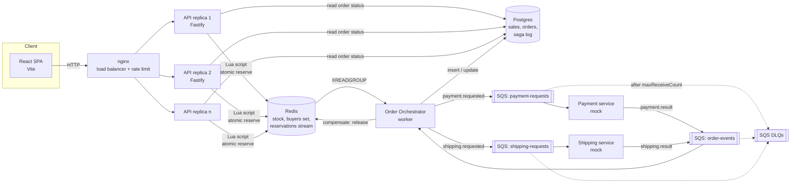
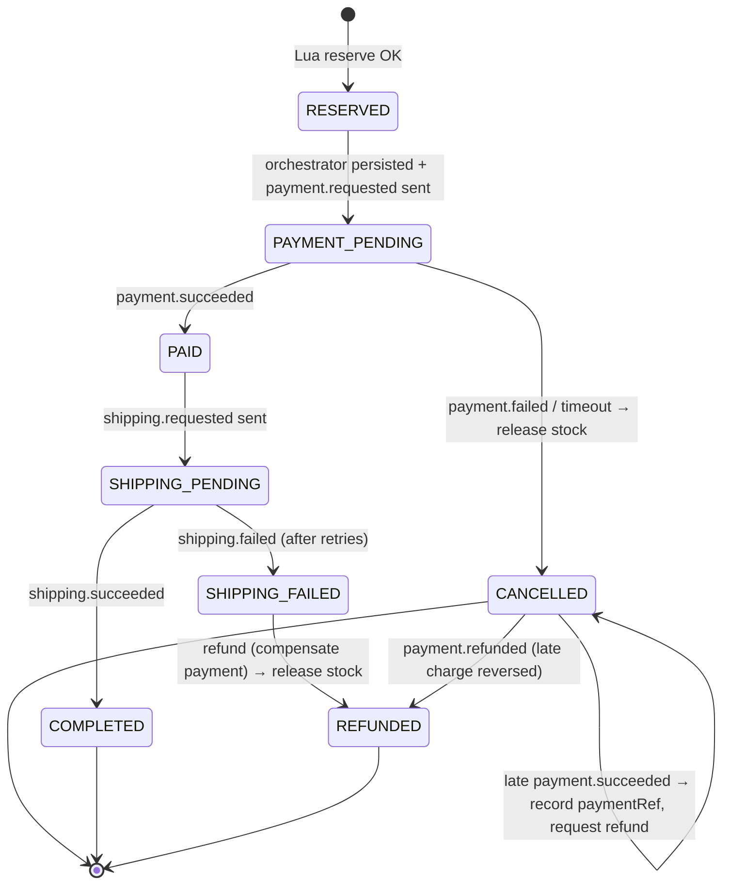

# Flash Sale System — Technical Specification

Status: Approved v0.1

---

## 1. Goals and non-goals

### Goals

- Sell **one product** with a **fixed stock** (N units) during a **configurable time window**.
- Allow **at most one unit per user** and **never oversell**, even under heavy concurrent load.
- Keep the purchase hot path **fast and horizontally scalable** (target: ≥ 5k req/s on a laptop with several API replicas).
- Recover cleanly from crashes of any single component without losing or duplicating orders.
- Run the whole stack locally with `docker compose up`. No cloud account needed.
- Model **payment and shipping as an asynchronous saga** with compensation, so that a failed payment returns the unit to stock.

### Non-goals

- Real authentication. Users are identified by a free-text `userId` (username/email), as the brief specifies.
- Real payment or shipping providers. Both are mocks with configurable latency and failure rates.
- Multiple products, carts, or multiple sales running at once. The schema keeps a `saleId` so these can be added later.
- Bot protection, CAPTCHA, or a waiting-room queue. These are discussed in §11 as future work.

---

## 2. Glossary

| Term             | Meaning                                                                                                  |
| ---------------- | -------------------------------------------------------------------------------------------------------- |
| **Sale**         | One flash sale event: `{ id, productId, startsAt, endsAt, totalStock }`.                                 |
| **Reservation**  | An atomic claim on one unit for one user, made in Redis on the hot path.                                 |
| **Order**        | The durable record in Postgres that is created from a reservation and moves through the saga.            |
| **Saga**         | The multi-step async flow reservation → payment → shipping, with compensating actions when a step fails. |
| **Compensation** | Undoing an earlier step. The main one is releasing a reservation back to stock.                          |

---

## 3. Architecture

### 3.1 Component diagram



### 3.2 Components

| Component              | Tech                                           | Responsibility                                                                                                              | Scaling                               |
| ---------------------- | ---------------------------------------------- | --------------------------------------------------------------------------------------------------------------------------- | ------------------------------------- |
| **Web**                | React + Vite + TypeScript                      | Show sale status, take `userId`, Buy Now, poll order status.                                                                | Static files                          |
| **Load balancer**      | nginx                                          | Round-robin to API replicas; per-IP rate limit (`limit_req`).                                                               | 1 (could be N behind DNS)             |
| **API**                | Node.js + **Fastify** + TypeScript             | Stateless HTTP. Validates input, runs the reserve Lua script, serves status reads.                                          | Horizontal, stateless                 |
| **Redis**              | Redis 7 (AOF `everysec`)                       | Source of truth **for the hot path**: remaining stock, buyers set, reservations stream (outbox).                            | Single primary (see §9.3)             |
| **Postgres**           | Postgres 16                                    | **Durable** source of truth: sales, orders, saga state. Unique constraints are the last line of defence against duplicates. | Single primary                        |
| **Order Orchestrator** | Node.js worker                                 | Reads the reservations stream, persists orders, and drives the saga state machine.                                          | N consumers in a Redis consumer group |
| **Payment service**    | Node.js worker                                 | Mock charge with configurable latency and failure rate. Idempotent on `orderId`.                                            | N consumers on the SQS queue          |
| **Shipping service**   | Node.js worker                                 | Mock shipment creation. Idempotent on `orderId`.                                                                            | N consumers on the SQS queue          |
| **Message broker**     | SQS API, served locally by **Floci** (see §10) | Queues between saga participants, with DLQs.                                                                                | —                                     |

### 3.3 Design decisions

1. **The decision is made in Redis, not the database.** One Lua script checks the sale window, the one-per-user rule and stock, then decrements stock, records the buyer, and appends an event, all in a single step. Redis runs scripts one at a time, so this is linearizable with no locks and no DB row contention. The script is O(1).
2. **The Redis stream is the outbox.** Writing the reservation and its event in the same script means there's never a reservation without an event, or the reverse. No two-phase commit is needed between Redis and the queue.
3. **Postgres stores the result durably, off the hot path.** The orchestrator writes orders asynchronously. `UNIQUE (sale_id, user_id)` makes duplicates impossible even if a stream message is delivered twice.
4. **The saga is orchestrated, not choreographed.** One state machine in the orchestrator is easier to read, test and explain than events bouncing between services.
5. **The API returns `202 Accepted` with a reservation.** The user learns immediately that they secured a unit. Payment and shipping finish asynchronously and are visible through the status endpoint.

---

## 4. Domain model

### 4.1 Sale state (derived, never stored)

```
now <  startsAt                   → UPCOMING
startsAt ≤ now < endsAt, stock>0  → ACTIVE
startsAt ≤ now < endsAt, stock=0  → SOLD_OUT
now ≥ endsAt                      → ENDED
```

The server clock is authoritative. Redis `TIME` is used inside the Lua script, so every API replica agrees on the time regardless of host clock drift.

### 4.2 Order state machine



**Rules**

- Transitions are applied with optimistic concurrency (`UPDATE ... WHERE id=$1 AND status=$expected`). If zero rows are updated, the order moved on concurrently, so the event is planned again against the current status. It may still owe a side effect (a late `payment.succeeded` that lost the race to the sweeper still owes a refund), or it may be a duplicate that plans nothing, in which case it is acked and ignored.
- **Releasing stock** (compensation) runs a Lua script that, only if this order's reservation is the one holding the user's unit (`sale:{id}:holders`), `HDEL`s the holder, `SREM`s the user and `INCR`s stock. It is idempotent: calling it twice releases once, and a stale event for an older order cannot release a newer one.
- **A release is durable.** The status commits first and `orders.released_at` is set after the release succeeds. The orchestrator's sweeper retries every `CANCELLED`/`REFUNDED` order with `released_at IS NULL`, so a crash or a Redis outage delays a release but cannot lose it. Until then the unit stays held and the user gets 409.
- **Result messages have derived ids** (`<orderId>:<type>`), so a redelivered request produces a result that `processed_messages` dedupes.
- After a release, the user may try again while the sale is ACTIVE and stock remains. This is an explicit product decision: a failed payment should not lock someone out.
- **Payment timeout:** if an order stays in `PAYMENT_PENDING` longer than `PAYMENT_TIMEOUT_MS` (default 60 s), a sweeper in the orchestrator cancels it and releases the stock. A late `payment.succeeded` on a cancelled order records the charge reference and triggers a refund; `payment.refunded` then moves the order to `REFUNDED`.

---

## 5. Data storage

### 5.1 Redis keys (per sale)

| Key                      | Type         | Contents                                         |
| ------------------------ | ------------ | ------------------------------------------------ |
| `sale:{id}:meta`         | Hash         | `startsAt`, `endsAt` (epoch ms), `totalStock`    |
| `sale:{id}:stock`        | String (int) | Remaining units                                  |
| `sale:{id}:buyers`       | Set          | `userId`s holding an active reservation or order |
| `sale:{id}:holders`      | Hash         | `userId` → the `reservationId` holding their unit |
| `sale:{id}:reservations` | Stream       | `{ reservationId, userId, ts }`, the outbox      |

All keys for a sale share the `{id}` hash tag, so they live in one slot if Redis Cluster is used later.

### 5.2 Reserve script (`reserve.lua`)

```lua
-- KEYS: meta, stock, buyers, stream, holders   ARGV: userId, reservationId
local t = redis.call('TIME'); local now = t[1]*1000 + math.floor(t[2]/1000)
local startsAt = tonumber(redis.call('HGET', KEYS[1], 'startsAt'))
local endsAt   = tonumber(redis.call('HGET', KEYS[1], 'endsAt'))
if not startsAt then return {'NOT_FOUND'} end
if now < startsAt then return {'NOT_STARTED'} end
if now >= endsAt then return {'ENDED'} end
if redis.call('SISMEMBER', KEYS[3], ARGV[1]) == 1 then return {'ALREADY_PURCHASED'} end
if tonumber(redis.call('GET', KEYS[2])) <= 0 then return {'SOLD_OUT'} end
redis.call('DECR', KEYS[2])
redis.call('SADD', KEYS[3], ARGV[1])
redis.call('HSET', KEYS[5], ARGV[1], ARGV[2])
redis.call('XADD', KEYS[4], '*', 'reservationId', ARGV[2], 'userId', ARGV[1], 'ts', now)
return {'RESERVED', ARGV[2]}
```

The script is loaded with `SCRIPT LOAD` at startup and called with `EVALSHA`.

### 5.3 Postgres schema

```sql
CREATE TABLE sales (
  id           TEXT PRIMARY KEY,
  product_id   TEXT        NOT NULL,
  starts_at    TIMESTAMPTZ NOT NULL,
  ends_at      TIMESTAMPTZ NOT NULL,
  total_stock  INT         NOT NULL CHECK (total_stock >= 0),
  CHECK (ends_at > starts_at)
);

CREATE TABLE orders (
  id              UUID PRIMARY KEY,          -- = reservationId
  sale_id         TEXT NOT NULL REFERENCES sales(id),
  user_id         TEXT NOT NULL,
  status          TEXT NOT NULL,
  payment_ref     TEXT,
  shipment_ref    TEXT,
  failure_reason  TEXT,
  released_at     TIMESTAMPTZ,               -- unit confirmed back in Redis
  created_at      TIMESTAMPTZ NOT NULL DEFAULT now(),
  updated_at      TIMESTAMPTZ NOT NULL DEFAULT now()
);
-- At most one live order per user per sale (cancelled/refunded ones don't count):
CREATE UNIQUE INDEX orders_one_live_per_user
  ON orders (sale_id, user_id)
  WHERE status NOT IN ('CANCELLED','REFUNDED');

CREATE TABLE saga_events (               -- append-only audit log
  id         BIGSERIAL PRIMARY KEY,
  order_id   UUID NOT NULL REFERENCES orders(id),
  type       TEXT NOT NULL,
  payload    JSONB NOT NULL,
  created_at TIMESTAMPTZ NOT NULL DEFAULT now()
);

CREATE TABLE processed_messages (        -- consumer-side idempotency
  consumer   TEXT NOT NULL,
  message_id TEXT NOT NULL,
  PRIMARY KEY (consumer, message_id)
);
```

**Invariant (checked in tests and by `/admin/reconcile`):**
`redis stock + count(orders live) + count(dead orders still holding their unit) + count(stream entries with no order that still hold a unit) = total_stock`

Redis is read atomically and Postgres in one statement, and the read repeats if Redis changed in between, so in-flight work is not reported as drift. A reservation refused by the partial unique index stays in the stream, but its unit has been returned, so it does not count.

---

## 6. API

Base path `/api`. JSON in and out. Validation uses Fastify JSON Schema (TypeBox).

### 6.1 `GET /api/sale`

Returns the sale status. Cached in-process for 250 ms per replica so status polling doesn't hammer Redis; concurrent cache misses share one Redis round trip. `status` and `serverTime` are derived from Redis `TIME` (the clock `reserve.lua` uses), never the replica's host clock. If the sale is defined but its Redis stock is missing, it returns 503 (fail closed).

```json
200 { "saleId": "launch-2026", "status": "ACTIVE",
      "startsAt": "2026-11-05T10:00:00Z", "endsAt": "2026-11-05T10:30:00Z",
      "remainingStock": 42, "totalStock": 100, "serverTime": "2026-11-05T10:05:12Z" }
```

### 6.2 `POST /api/purchases`

```json
request  { "userId": "alice@example.com" }
```

- `userId`: trimmed and lowercased, 1–254 characters, `^[\w.@+-]+$`.
- An optional `Idempotency-Key` header. A retry with the same key returns the original response (cached in Redis for 10 min).

| Outcome                  | HTTP    | Body `code`                     |
| ------------------------ | ------- | ------------------------------- |
| Reserved                 | **202** | `RESERVED` + `orderId`          |
| Already has a live order | **409** | `ALREADY_PURCHASED` + `orderId` |
| Sold out                 | **410** | `SOLD_OUT`                      |
| Not started              | **403** | `NOT_STARTED`                   |
| Ended                    | **403** | `ENDED`                         |
| Invalid input            | **400** | `VALIDATION_ERROR`              |
| Rate limited (nginx/API) | **429** | `RATE_LIMITED`                  |
| Redis unavailable        | **503** | `UNAVAILABLE` + `Retry-After`   |

### 6.3 `GET /api/purchases/:userId`

Reads Postgres first, then falls back to Redis, because a reservation can exist before the orchestrator has persisted it.

```json
200 { "userId": "alice@example.com", "secured": true, "orderId": "…",
      "status": "PAYMENT_PENDING", "updatedAt": "…" }
404 { "secured": false }
```

`secured` is `true` for `RESERVED | PAYMENT_PENDING | PAID | SHIPPING_PENDING | COMPLETED`.

### 6.4 Operations endpoints

- `GET /healthz` (liveness) and `GET /readyz` (Redis + PG reachable).
- `POST /admin/sale` (dev only, guarded by `ADMIN_TOKEN`; not registered when `ADMIN_TOKEN` is unset): create or reset a sale. Seeds Postgres, then Redis, clearing the buyers set and stream while keeping the stream's consumer groups. Returns 409 `SALE_HAS_ORDERS` while the sale has live reservations or active orders.
- Startup seeding from `SALE_*` only creates a missing sale. It never overwrites an existing sale or re-initialises Redis stock for one; if that stock is missing, the sale stays unavailable until reset or the Redis rebuild job runs.
- `GET /admin/reconcile`: checks the stock invariant from §5.3 and reports any drift: 200 when it holds, 409 on drift, 503 with `Retry-After` and `settled: false` when traffic never paused long enough for a consistent read.
- `GET /metrics`: Prometheus format (request rate, latency histogram, reserve outcomes, queue lag).

---

## 7. Saga messages

Every message carries an envelope:

```ts
interface Envelope<T> {
  messageId: string; // uuid; idempotency key for consumers
  orderId: string;
  type: string; // e.g. 'payment.requested'
  attempt: number;
  occurredAt: string;
  payload: T;
}
```

| Queue               | Producer → Consumer             | Types                                                                                              |
| ------------------- | ------------------------------- | -------------------------------------------------------------------------------------------------- |
| `payment-requests`  | Orchestrator → Payment          | `payment.requested`, `payment.refund_requested`                                                    |
| `shipping-requests` | Orchestrator → Shipping         | `shipping.requested`                                                                               |
| `order-events`      | Payment/Shipping → Orchestrator | `payment.succeeded`, `payment.failed`, `payment.refunded`, `shipping.succeeded`, `shipping.failed` |

- **Delivery:** at-least-once. Each consumer records `messageId` in `processed_messages` in the same transaction as its side effect.
- **Retries:** SQS visibility timeout 30 s, `maxReceiveCount` 5, then a per-queue **DLQ**. DLQ depth is exposed as a metric.
- **Broker abstraction:** the code depends on a `MessageBus` interface (`publish`, `subscribe`). Adapters: `SqsBus` (AWS SDK v3 pointed at Floci, ElasticMQ or real SQS) and `InMemoryBus` (unit tests).

---

## 8. Frontend

A single page, React 18 + Vite + TypeScript, with no UI framework requirement.

- **Status banner:** polls `GET /api/sale` every 1 s and shows a countdown to start or end using the `serverTime` offset, plus remaining stock.
- **Form:** `userId` input and a **Buy Now** button. The button is disabled unless the sale is ACTIVE, and while a request is in flight (prevents double clicks).
- **Feedback** is mapped from the response code: 🎉 Reserved / ✅ Already purchased / ❌ Sold out / ⏰ Not started / 🔒 Ended / ⚠️ Try again.
- **After a reservation**, polls `GET /api/purchases/:userId` every 2 s until the order reaches a final state, and shows a progress line: Reserved → Paid → Shipped (or Cancelled, with the reason).
- Generates a per-click `Idempotency-Key`, so a network retry won't create a second reservation.

---

## 9. Non-functional requirements

### 9.1 Throughput and latency targets (local, docker compose, 4 API replicas)

| Metric                           | Target        |
| -------------------------------- | ------------- |
| `POST /api/purchases` throughput | ≥ 5,000 req/s |
| p99 latency (purchase)           | < 50 ms       |
| Error rate (non-4xx)             | < 0.1 %       |
| Oversell                         | **0**, always |
| Duplicate per user               | **0**, always |

### 9.2 Bottlenecks and mitigations

| Bottleneck                           | Mitigation                                                                                                                                    |
| ------------------------------------ | --------------------------------------------------------------------------------------------------------------------------------------------- |
| DB write contention on one stock row | Stock lives in Redis. The DB is written asynchronously, one row per order, with no hot row.                                                   |
| Redis single thread                  | The script is O(1) at about 10 µs, so one Redis handles roughly 100k scripts/s. Per-IP rate limiting at nginx sheds abusive load.             |
| Status polling storms                | 250 ms in-process cache per replica, plus a `Cache-Control: max-age=1` header.                                                                |
| Thundering herd after sell-out       | A per-replica in-memory `soldOut` flag, set when a script returns `SOLD_OUT`, short-circuits with 410 and skips Redis (re-checked every 1 s). |
| Node event loop                      | Fastify, no sync work on the hot path, connection pooling (ioredis, pg Pool).                                                                 |

### 9.3 Failure modes

| Failure                            | Behaviour                                                                                                                                                                                                                                                                                                                                                                                           |
| ---------------------------------- | --------------------------------------------------------------------------------------------------------------------------------------------------------------------------------------------------------------------------------------------------------------------------------------------------------------------------------------------------------------------------------------------------- |
| API replica crashes                | nginx routes around it and re-resolves the name, so the restarted replica rejoins even on a new IP. The API is stateless, so nothing is lost.                                                                                                                                                                                                                                                                                                                                   |
| Redis crashes                      | Purchases return 503 (fail closed, never oversell). With AOF `everysec`, at most about 1 s of reservations can be lost on restart. The orchestrator detects the restart (a new Redis `run_id`, polled every second), deletes `stock` so `reserve.lua` answers UNAVAILABLE and `release.lua` refuses, and runs the **rebuild job**, which recomputes `stock`, `buyers` and `holders` from Postgres plus unconsumed stream entries before traffic resumes. Purchases that land between the restart and that detection are still in the stream and are counted. If all data was lost there is no stock key, so the sale stays closed until `pnpm rebuild-redis` runs. Production would use Redis Sentinel or a managed replica with `WAIT` for stronger durability. This trade-off is documented in the README. |
| Orchestrator crashes mid-message   | The stream entry stays pending. Another consumer reclaims it with `XAUTOCLAIM` after 30 s. The insert is idempotent (`ON CONFLICT DO NOTHING`).                                                                                                                                                                                                                                                     |
| Postgres down                      | Purchases keep working (Redis only). The orchestrator backs off and the stream buffers events. It also stops receiving `order-events`, so results wait in SQS instead of using up their receives and reaching the DLQ. A restarted API replica serves the sale already in Redis. A restarted orchestrator exits until Postgres returns, and the restart policy retries it. Status reads fall back to Redis.                                                                                                                                                                                                                                                                     |
| Payment or shipping service down   | Messages wait in SQS. The payment timeout sweeper cancels and releases stock if it's down too long.                                                                                                                                                                                                                                                                                                 |
| Poison message                     | Goes to the DLQ after 5 receives and is alerted on through metrics.                                                                                                                                                                                                                                                                                                                                 |
| Duplicate or out-of-order messages | `processed_messages` plus conditional state transitions (§4.2).                                                                                                                                                                                                                                                                                                                                     |
| Graceful shutdown                  | On SIGTERM: stop accepting, drain in-flight requests and messages, then exit (Fastify `close`, consumer stop).                                                                                                                                                                                                                                                                                      |

---

## 10. Local infrastructure and the LocalStack question

**Decision: use Floci (`floci/floci`, pinned to an exact version such as `2.4.0`) for SQS. Don't depend on LocalStack. ElasticMQ is the fallback.**

- Since **March 2026**, LocalStack merged its Community and Pro images. `localstack/localstack:latest` now **requires an account and `LOCALSTACK_AUTH_TOKEN`**. The free **Hobby** tier is limited to **non-commercial use**. A job-application take-home sits in a grey area, and reviewers would need to sign up just to run the project. Pinning an old community image (`4.x`) works without a token but is frozen.
- **Floci** is an MIT-licensed AWS emulator that needs no account and no token. It runs on the same port as LocalStack (`4566`), starts in milliseconds and uses about 13 MiB of memory when idle. Its SQS emulation covers everything the saga needs: standard and FIFO queues, a `RedrivePolicy` with `maxReceiveCount` (DLQs), visibility timeout and `ChangeMessageVisibility`, long polling (`WaitTimeSeconds` up to 20) and batch send/delete. It also emulates SNS and Step Functions if the design ever moves fan-out or orchestration onto AWS-managed services. There's a web console at `http://localhost:4566/_floci/ui` for inspecting queues during the demo.
- **Risks, and how we limit them:** Floci is a young project that releases several times a month (2.0 → 2.4 between Sep and Oct 2026), and its compatibility claims come from the vendor. So we (a) **pin an exact image tag**, never `latest`, (b) only use the plain SQS API through AWS SDK v3, and (c) cover the queue behaviour we depend on (DLQ after N receives, redelivery after visibility timeout) in integration tests. If Floci misbehaves, switching to **ElasticMQ** (`softwaremill/elasticmq-native`, an SQS-only emulator, Apache-2.0, mature) or to real SQS only requires changing `SQS_ENDPOINT`.
- **Queue setup:** Floci has no queue config file, so a one-shot `queue-init` compose service creates the queues and DLQs with `CreateQueue` and `SetQueueAttributes` (both safe to re-run) before the workers start (`depends_on: condition: service_completed_successfully`).
- Only SQS is needed. Step Functions would replace the orchestrator, but it adds infrastructure without showing more design skill, and it hides the saga logic that reviewers want to see.

`docker-compose.yml` services: `nginx`, `api` (×4 via `deploy.replicas`), `orchestrator` (×2), `payment` (×2), `shipping` (×1), `redis`, `postgres`, `floci` (port 4566), `queue-init` (one-shot), `web`.

---

## 11. Repository layout

```
.
├── apps/
│   ├── api/            Fastify server
│   ├── orchestrator/   stream consumer + saga state machine + timeout sweeper
│   ├── payment/        mock payment worker
│   ├── shipping/       mock shipping worker
│   └── web/            React + Vite
├── packages/
│   ├── core/           domain types, state machine, pure business rules
│   ├── infra/          redis scripts, pg repo, MessageBus (Sqs/InMemory)
│   └── config/         env parsing (zod)
├── infra/
│   ├── docker-compose.yml
│   ├── nginx.conf
│   ├── init-queues.ts  queue + DLQ bootstrap (queue-init service)
│   └── migrations/     SQL
├── stress/             k6 scripts
├── doc/                SPEC.md, architecture diagram
└── README.md
```

Tooling: pnpm workspaces, TypeScript (strict), ESLint and Prettier, Vitest, Testcontainers.

### Configuration (env)

`SALE_ID`, `SALE_STARTS_AT`, `SALE_ENDS_AT`, `SALE_TOTAL_STOCK`, `REDIS_URL`, `DATABASE_URL`, `SQS_ENDPOINT`, `AWS_REGION`, `PAYMENT_FAILURE_RATE` (default 0.1), `PAYMENT_LATENCY_MS` (default 200–800), `SHIPPING_FAILURE_RATE` (default 0.02), `PAYMENT_TIMEOUT_MS`, `ADMIN_TOKEN`, `RATE_LIMIT_RPS`.

---

## 12. Testing

### 12.1 Unit tests (Vitest, no I/O)

- Sale status derivation at the window boundaries (`startsAt - 1ms`, `startsAt`, `endsAt - 1ms`, `endsAt`).
- `userId` normalisation and validation.
- Saga state machine: every legal transition, rejection of illegal ones, and compensation paths (payment fail → release; shipping fail → refund → release; late payment success after cancel → refund).
- Response mapping from reserve results to HTTP codes.

### 12.2 Integration tests (Vitest + Testcontainers: Redis, Postgres, Floci)

- The reserve Lua script: happy path, duplicate user, sold out, outside the window, release idempotency.
- **Concurrency:** fire 1,000 parallel `reserve` calls for stock = 100 with 1,000 distinct users → exactly 100 `RESERVED` and 900 `SOLD_OUT`, stock = 0.
- **Same user hammering:** 500 parallel calls for one user → exactly 1 `RESERVED`.
- API (Fastify `inject`): every endpoint and response code from §6.
- End-to-end saga with `PAYMENT_FAILURE_RATE=1` → order CANCELLED, stock restored, user can buy again.
- **Broker contract** (runs against Floci, and must pass unchanged on ElasticMQ): a message that is not deleted comes back after the visibility timeout; after `maxReceiveCount` receives it lands in the DLQ; batch send/delete work.
- Orchestrator crash simulation: consume without ack, kill it, start a new consumer → order persisted exactly once.

### 12.3 Stress tests (k6, against the full docker compose stack)

| Scenario            | Setup                                                                    | Pass criteria                                           |
| ------------------- | ------------------------------------------------------------------------ | ------------------------------------------------------- |
| **Spike**           | 10k virtual users, distinct ids, stock 1,000, ramp to peak in 5 s        | Exactly 1,000 × 202; the rest 410; p99 < 50 ms; 0 × 5xx |
| **Same-user abuse** | 2k VUs sharing 50 user ids                                               | ≤ 50 reservations; one per id                           |
| **Soak**            | 2k req/s for 5 min                                                       | Steady latency, no memory growth, queue lag recovers    |
| **Chaos**           | Spike plus `docker kill` of one API replica and one orchestrator mid-run | No oversell; all reservations eventually persisted      |

After every run, `stress/verify.ts` queries Postgres and Redis and asserts:
`live orders ≤ totalStock`, `count(distinct user_id) = count(live orders)`, the §5.3 invariant holds, and the DLQ is empty. k6 summary JSON plus the verification output are saved to the git-ignored `stress/results/`, and `stress/README.md` explains how to read them.

---

## 13. Deliverables checklist

- [x] `README.md`: design and trade-offs, the diagram (Mermaid from §3.1 plus an exported PNG), how to run the server, web, tests and stress tests, and a stress results summary.
- [x] `docker compose up` brings up the full stack. `pnpm dev` runs the API and web against compose infrastructure.
- [x] `pnpm test` (unit), `pnpm test:int` (Testcontainers), `pnpm stress` (k6 + verify).
- [x] Architecture diagram in `doc/`.

---

## 14. Delivery milestones

1. **Core (enough to meet the brief):** API, Redis Lua reserve, Postgres persistence via the stream, React page, unit and integration tests, spike stress test. _Payment is simulated as "instant success" here._
2. **Saga:** Floci (SQS), payment and shipping workers, compensation, timeout sweeper, DLQs, saga tests.
3. **Hardening:** rate limiting, sold-out short-circuit, metrics, chaos stress test, Redis rebuild job, README polish.

Milestone 1 alone satisfies `idea.md`. Milestones 2–3 go beyond it and show the fault-tolerance thinking. Cut scope from the end if time is short.

---

## 15. Decisions (resolved open questions)

1. **Retry after a failed payment:** yes. The unit is released and the user may buy again while stock remains.
2. **Meaning of "secured":** _reserved_, counted from the moment of the Redis decision. Payment status is shown separately.
3. **Admission control:** per-IP rate limiting only. A waiting room or virtual queue is future work.
4. **Runtime:** Node 26 LTS ("Lithium"), pinned to an exact image tag (`node:26.13.0-alpine3.24`). The project started on Node 24. It moved to 26 once 26 became Active LTS (2026-10-28), because 24 is now in maintenance LTS and gets fewer fixes. Container images must have no HIGH or CRITICAL findings in a Trivy scan. The HIGH findings in the official `node` images (`brace-expansion`, `undici`) come from the npm that ships with Node, not from Node itself, and every Node version has them. So the image installs pnpm and then deletes npm and npx, which nothing uses at runtime. The web and load-balancer images use `nginx:1.30.6-alpine3.24`. `1.27.3` had 3 CRITICAL and 37 HIGH findings.
